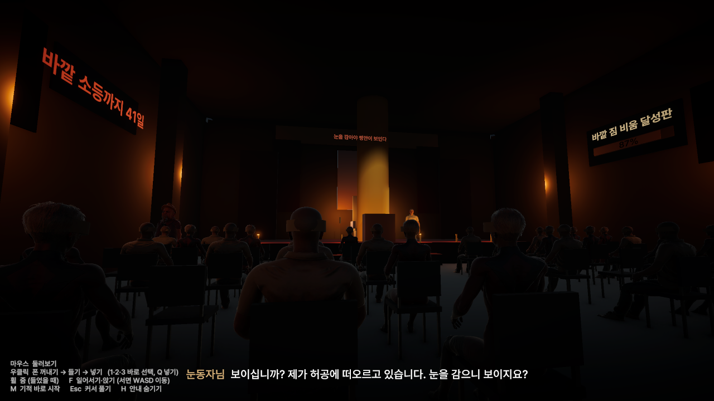
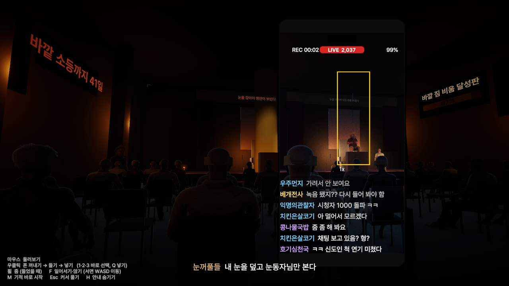

# 잠입 라이브 (가제)

사이비 집회에 신도인 척 들어간 유튜버가 되어, 폰을 들었다 내렸다 하며 들키지 않고 결정적인 장면을 찍는 1인칭 잠입 게임입니다. 시리어스 게임 수업의 '시점 실험' 과제로 만든 프로토타입입니다.

**바로 플레이: https://leeyekrj.github.io/undercover-live/**
PC 브라우저에서 마우스와 키보드로 합니다. 처음 불러올 때 시간이 조금 걸립니다.

| 맨눈 | 폰을 들었을 때 |
|---|---|
|  |  |

맨눈에는 교단이 보여 주고 싶은 '기적'이, 폰 카메라에는 와이어와 적외선 감시 카메라, 현수막의 속뜻이 보입니다.

## 조작

| 키 | 동작 |
|---|---|
| 마우스 | 둘러보기 (앉은 자리에서 고개만) |
| 우클릭 | 폰 꺼내기(몰래) → 들기(정조준) → 넣기. 1·2·3으로 바로 선택, Q로 넣기 |
| 휠 | 폰을 든 채 줌 |
| M | 기적 바로 시작 |
| F | 일어서기·앉기, 서면 WASD로 걷기 (시험용) |
| H / Esc | 안내 숨기기 / 커서 풀기 |
| R | 엔딩 화면에서 다시 하기 |

## 들어간 것

- **두 개의 현실**: 맨눈 카메라와 폰 카메라가 서로 다른 레이어(`EyeOnly`·`PhoneOnly`)를 그립니다. 후처리도 다릅니다.
- **판정**: 화면에 담긴 크기, 가려짐, 흔들림, 유지 시간으로 S~C 등급을 매기고, 시청자 수와 채팅이 반응합니다.
- **의심**: 신도, 관리자 두 명, 교주의 시선, 천장 감시 카메라. 폰을 들고 있으면 의심 표시가 사라지고 채팅이 대신 알려 줍니다.
- **엔딩**: 예배를 끝까지 버티면 업로드 결과 화면, 들키면 방송 종료 화면.

교단과 교리는 모두 가상입니다. 실존 단체의 이름·상징·교리는 쓰지 않았습니다.

## 프로젝트 열기

- Unity **6000.6.8f1**, URP. 씬은 `Assets/_Game/Scenes/Chapel.unity`입니다.
- **Mixamo 인물·동작 FBX는 레포에 없습니다.** Adobe 약관상 원본 파일은 다시 배포할 수 없어서 뺐습니다(빌드된 게임에는 들어 있습니다). [Mixamo](https://www.mixamo.com)에서 `FBX for Unity`로 받아 아래 이름으로 넣으면 씬이 그대로 열립니다.
  - `Assets/_Game/Mixamo/Characters/`: `char_leader_a` · `char_staff_a` · `char_believer_c` · `char_believer_d` · `char_man_casual` · `char_man_suit` · `char_woman_casual` (With Skin)
  - `Assets/_Game/Mixamo/Animations/`: `anim_sitting_idle` · `anim_sitting_clap` · `anim_sitting_talking` · `anim_praying` · `anim_hand_raising` · `anim_kneeling` · `anim_kneeling_idle` · `anim_meeting_male` · `anim_standing_cheering` · `anim_standing_idle` · `anim_talking` · `anim_walking_inplace` (Without Skin)

## 웹 빌드와 배포

```sh
tools/build-web.sh                  # Builds/WebGL 에 빌드 (에디터를 열어 둔 채로 가능)
tools/deploy-pages.sh Builds/WebGL  # gh-pages 브랜치로 올리기 → 1~2분 뒤 링크에 반영
```

- `build-web.sh`는 프로젝트 복사본(`Builds/_work`)에서 배치 모드로 빌드합니다. 열어 둔 에디터와 부딪히지 않고, 복사본을 남겨 두면 다음 빌드가 빨라집니다.
- 복사본에서는 `com.unity.ai.inference`를 뺍니다. 이 패키지가 끌고 오는 `app-ui`의 웹 플러그인이 이 버전의 웹 링커와 맞지 않아 링크가 실패하기 때문입니다. 게임은 이 패키지를 쓰지 않습니다. 같은 이유로 에디터 메뉴 `UndercoverLive > Build WebGL (GitHub Pages)`는 이 패키지가 있으면 실패합니다.
- GitHub Pages는 압축 파일에 `Content-Encoding` 헤더를 붙이지 못해서, gzip에 압축 풀기 대비책(decompression fallback)을 켜고 빌드합니다. 페이지 틀은 `Assets/WebGLTemplates/Undercover`입니다.
- `gh-pages` 브랜치에는 매번 빌드 한 벌만 남습니다. 파일 하나가 100MB를 넘으면 GitHub에 올라가지 않으니 에셋을 늘릴 때 확인하세요.
